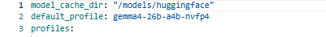
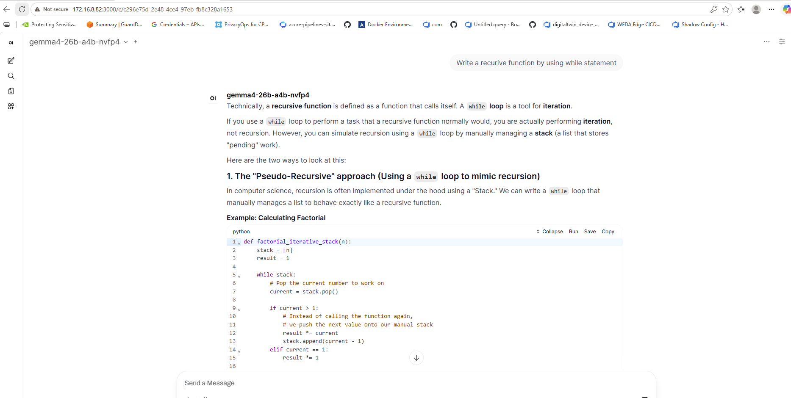

# WEDA-LLM-Cognitive-RAG Serving & Verification Environment

A serving and verification environment for deploying the **Advantech WEDA-LLM-Cognitive-RAG Container** on the **NVIDIA Jetson AGX Thor (`sm_110a`)** platform. It combines high-performance model serving (via `vLLM`), a retrieval and agent toolchain, and diagnostics tuned for Jetson's unified memory (UMA) Blackwell architecture — the whole stack running on the device, with no cloud dependency.

---

## 🧠 What "Cognitive RAG" Means Here

Classic RAG is a single hop: embed the question, fetch the nearest chunks, paste them into the prompt, answer. It works until the question needs more than one lookup, or the first retrieval comes back weak.

**Cognitive RAG** adds a reasoning loop around retrieval. The model decides *what* to look up, judges whether what came back is good enough, and retrieves again or switches source before answering. Retrieval becomes a step the model controls rather than a fixed preprocessor.

| Stage | Classic RAG | Cognitive RAG |
|---|---|---|
| Query | used verbatim | rewritten, decomposed into sub-questions |
| Retrieval | one vector search | hybrid dense + keyword, multiple rounds |
| Quality control | none | relevance graded; re-query on a weak hit |
| Sources | one index | local index, web search, tools |
| Control flow | fixed chain | stateful graph with branching and loops |

### What ships in the container

The image carries the components this pattern needs, all resident on the device:

| Capability | Provided by |
|---|---|
| Inference serving | `vLLM` — OpenAI-compatible API on port 9000 |
| Vector storage | `chromadb`, `faiss-cpu` |
| Embeddings & reranking | `sentence-transformers` |
| Keyword retrieval (hybrid search) | `rank-bm25` |
| Agent & graph orchestration | `langchain`, `langgraph` |
| External knowledge | `tavily-python` |
| Chat interface with document upload | Open WebUI on port 3000 |

Open WebUI gives you document-grounded chat immediately — upload files, build a knowledge collection, ask questions against it. The `langgraph` and retrieval libraries are there to build the multi-step behaviour described above on top of the same served model.

> This bundle ships the **platform**, not a finished application. Serving, retrieval, embedding, orchestration and the UI are installed, verified and ready; the retrieval graph for your data is what you build on it.

### Choosing a model for RAG

Every profile serves an OpenAI-compatible endpoint, so any of them *works*. What separates them for retrieval is context length (retrieved chunks are long), instruction-following (answer from the context, don't confabulate), and tool-calling quality for the multi-step loop. Run
`python3 scripts/download_models.py --list` to see the full catalogue.

| Profile | Ctx | Why |
|---|---|---|
| **`qwen3-30b-a3b-w4a16-marlin-fp8kv`** | 32k | FP8 KV cache halves the memory a long context costs; 64 concurrent requests. |
| **`nemotron3-nano-30b-a3b-nvfp4`** | 32k | NVFP4 native on Blackwell, NVIDIA-tuned instruction following. |
| **`qwen3-30b-a3b-nvfp4`** | 32k | Same class, lighter footprint if the device is shared. |
| **`qwen3-vl-30b-a3b-awq-marlin`** | 32k | **Multimodal.** Retrieval over scanned PDFs, schematics and photos. |
| `gpt-oss-120b-mxfp4` | 32k | Strongest reasoning, but prefill is slow — and RAG is prefill-heavy. |
| `llama3.1-8b-nvfp4` | 32k | Fast and light; weaker at synthesising across several documents. |
| `llama3.3-70b-nvfp4` | 16k | High quality, but the tightest window of the large models. |

The 30B MoE profiles (`a3b`) activate roughly 3B parameters per token, so they give large-model comprehension at small-model latency — which is what matters when every RAG turn pushes thousands of context tokens through prefill.

**Not top pick RAG:**

* `qwen2.5-0.5b-sanity` — a health-check model. It proves the stack serves; it will not follow retrieval instructions or emit usable tool calls for images.Still works for simple rag applications
* `llama3.1-8b-bf16` — 8k context. Tool schemas plus retrieved chunks overflow it.

### Where it fits

* **Industrial and field service** — equipment manuals, wiring diagrams and maintenance logs queried on a machine with no internet link.
* **Regulated and air-gapped sites** — documents never leave the device, which is why `HF_HUB_OFFLINE=1` is the default.
* **Multi-step operational questions** — "which alarms preceded this fault, and what does the manual say to do about them" needs several retrievals and a decision between them.
* **Latency-bound assistance** — an operator waiting at a panel; a round trip to a datacentre is the slowest part of a cloud design.
* **Private assistants on fixed hardware** — a Thor module serving a cell, a vehicle, or a site, sized to what the box can hold.

---

## 🌟 Key Features

| Optimization Category | Technical Feature | Uniqueness & Capabilities | Ease of Operation | Direct Operator Benefits |
| :--- | :--- | :--- | :--- | :--- |
| **Performance Acceleration** | **Persistent Compilation Caching** | Dynamically binds compilation artifacts (`/root/.cache/vllm`) to a persistent volume cache. | Automatically handled; no manual file transfers or caching rules needed. | Eliminates the costly ~26-second JIT graph compilation time on every container start. |
| **System Compatibility** | **Auto-Patched JIT Compiler** | Patches Triton's bundled assembler directly to the host's sm_110a-aware CUDA toolkit assembler. | Native patching runs automatically within the container entrypoint. | Prevents silent kernel compile failures and crashes during runtime execution. |
| **Runtime Efficiency** | **Model Swapping Configuration** | A unified parser (`config/loader.py`) reads profiles and restarts services upon configuration changes. | Hot-swaps models instantly upon saving edits to `config/llm_config.yaml`. | Allows rapid, non-disruptive testing of different quantization configurations and architectures. |
| **Resource Management** | **UMA Memory Optimization** | Automatically synchronizes and flushes host page caches and dentries prior to model allocation. | Handled automatically before launching vLLM or during diagnostic benchmark sweeps. | Frees locked unified memory to prevent Out of Memory (OOM) failures on Jetson Thor. |
| **Diagnostics & Health** | **Verification Scorecard** | Self-contained environment verification suite testing CUDA libraries, dependencies, and imports. | Simple execution: `./wise-bench` executes comprehensive checks and reports scores. | Confirms hardware access and prevents serving runs on broken dependencies. |

---

## ⚙️ System Requirements

Before running the serving stack, ensure your host environment meets the following specifications:

*   **Processor & Platform:** NVIDIA Jetson AGX Thor (`sm_110a` GPU architecture)
*   **Operating System & Software:** [NVIDIA JetPack](https://developer.nvidia.com/embedded/jetpack) SDK ≥ 7.1 (L4T with CUDA toolkit 13.x installed)
*   **Container Runtime:** Docker with [NVIDIA Container Toolkit](https://github.com/NVIDIA/nvidia-container-toolkit) (`--runtime nvidia` configured as default or specified)
*   **Python (Host):** Python 3.12+ (required for running the host-level benchmarking suite `./wise-bench`)

---

## 🚀 Quick Start Guide

### 1. Configuration Check
Create or update the environment configuration file `.env` in the root of this directory. It must define your Hugging Face credentials and local model cache directories:
```bash
# Hugging Face
#HF_TOKEN=                       # uncomment and set for gated repositories
HF_HUB_OFFLINE=1                 # models must already be in HF_CACHE
HF_CACHE=/home/<username>/.cache/huggingface
```

`HF_HUB_OFFLINE=1` means nothing is fetched at serve time — a model that is not already in `HF_CACHE` is a start-up failure, not a slow first run. Download it first (step 2). `HF_TOKEN` is only needed for gated repositories.

### 2. Download and Cache Models
Run the downloader on the host to cache the weight checkpoints. It resolves everything through `config/llm_config.yaml`, so there is no list to edit inside the script:

```bash
python3 scripts/download_models.py                     # default_profile's model only
python3 scripts/download_models.py --list              # profiles and their models
python3 scripts/download_models.py --profile <NAME>    # one specific profile
python3 scripts/download_models.py --all               # every model referenced by any profile
```

With no flag it fetches only the model served by `default_profile`, which is enough to bring the stack up. Use `--profile` for the one you intend to serve, or `--all` to cache the full catalogue. See [Choosing a model for RAG](#choosing-a-model-for-rag) for which profile to pick — the default is a sanity model, not a RAG model.

### 3. Build & Launch the Serving Infrastructure
Launch the serving container:
Before running the build.sh update the config/llm_config.yaml file model profile for the model you have downloaded above.
For example: replace default_profile with the model you have downloaded.


```bash
./build.sh --run
```
This checks that the model to serve is already in `HF_CACHE` (and names the download command when it is not), starts the vLLM service using the local image (a plain `./build.sh` pulls first), waits for it to report healthy, then starts open-webui. A profile the server refuses (model not cached, does not fit in memory, port held by another process) is reported here with the reason.

### 4. Wait for the Model to Load
After launching, the vLLM server needs time to load the model weights into memory. **Wait times vary depending on the model size and parameters** — a 7B-parameter model may take ~2–5 minutes, while larger 70B+ models can take 10–20 minutes or more.

Monitor container status in real-time:
```bash
watch -n 2 docker ps
```
Wait until the container status shows `healthy`. Then confirm the model is fully loaded and available by polling the vLLM models endpoint:
```bash
curl -s http://localhost:9000/v1/models | python3 -m json.tool
```
When the response returns a valid model list with your model ID, the server is ready.

> **💡 Tip:** If the container shows `unhealthy` or the `/v1/models` endpoint returns an empty list after an extended period, check the container logs with `docker logs weda-edge-llm --tail 100` to diagnose loading issues.

**Container lifecycle.** `scripts/serve.py` supervises the vLLM server: while the server answers `/health` the container is `healthy` and `.ready` exists; if the running server dies, the container exits with the server's exit code and Docker restarts it (`restart: unless-stopped`), so `docker ps` shows `Restarting` instead of a silent `Up`. A profile that cannot start at all (bad config, model missing from the cache, does not fit in memory, port already served by another process) leaves the container up and idle with the reason in `docker logs` and in `.launch-failed` -- fix `config/llm_config.yaml` and save it; the server relaunches without a container restart. A profile edit that crashes right after a hot swap idles the same way instead of taking a working container down. A fresh start is not counted as failing for the first hour (the slowest profile's `server_ready_sec`), and after that 40 further failed probes (10 min) are needed before Docker reports `unhealthy` -- so the earliest a container that never answers is marked `unhealthy` is about 70 minutes. Once the server has answered once, the grace is gone: 10 minutes of failed probes is enough, so a hot swap into a model that loads longer than that shows `unhealthy` until it answers, even though the swap itself may still be in progress -- the supervisor's own state (in `docker logs` and `.ready`/`.launch-failed`) is the source of truth during a swap, not the healthcheck status. `./build.sh --run` checks that the model to serve is in `HF_CACHE` before anything starts when pyyaml is available on the host (the container refuses an uncached model in any case), waits on `.ready`, stops the moment `.launch-failed` appears and prints its reason, and then starts `open-webui` -- immediately when the API is already healthy, or after the 1200s wait with `--no-deps` on a timeout, in which case the UI shows a connection error until the API comes up.

### 5. Verify the Environment
Run the built-in verification suite to confirm that the container is fully operational, all packages are correctly installed and synced, and the serving endpoints are healthy:
```bash
./wise-bench #(run from host in the project directory for complete comprehensive analysis of ready to dev capabilities along with the package and functionalities report)
```
This executes a comprehensive check inside the running container (CUDA libraries, Python dependencies, compilation tests) followed by endpoint health checks for Open WebUI and vLLM. A successful run confirms the environment is **ready to dev**.

Once the wise-bench test result is passed, access the webui using the following:
**Access URL**
    http://<device-ip>:3000
**Expected result**


for further details and customization of OpenWebUI and its parameters please refer to quick start Guide https://docs.openwebui.com/#quick-start.

---

## 📁 Scripts & Core Files

This directory contains the following scripts and core files:

*   [`build.sh`](./build.sh): **Host Orchestration.** Build, start, shell-attach, stop, and clean up container services.
*   [`entrypoint.sh`](entrypoint.sh): **Container Lifecycle Init.** Runs inside the container on start: repoints Triton's `ptxas` to the sm_110a-aware CUDA toolkit, reports the detected GPU, sets the vLLM/inductor tuning variables, and hands off to the serving command.
*   [`wise-bench`](./wise-bench): **Root Diagnostic & Health Tool.** Verifies the status of Open WebUI, checks the vLLM model API, and measures inference latency (TTFT and decode throughput).
*   [`scripts/download_models.py`](./scripts/download_models.py): **Host Model Downloader.** Caches specified Hugging Face models directly to the local model cache directory.
*   [`scripts/serve.py`](./scripts/serve.py): **Container Model Launcher.** Watches `llm_config.yaml` to dynamically launch, restart, and hot-swap running LLM instances.
*   [`scripts/test_curl.sh`](./scripts/test_curl.sh): **Endpoint Testing Script.** A helper curl invocation script to test simple vLLM completions endpoint responses.
*   [`config/llm_config.yaml`](./config/llm_config.yaml): **Central Configuration.** Profile catalog defining served models, execution args, GPU resource configurations, expected latency thresholds, and benchmarks.
*   [`config/loader.py`](./config/loader.py): **Config Parser.** Reads `llm_config.yaml` and resolves the selected profile into the serve arguments used by `scripts/serve.py`.
*   [`docker-compose.yml`](./docker-compose.yml): **Service Definition.** Declares the vLLM and Open WebUI services, ports, volume mounts, healthchecks, and log rotation.
*   [`Dockerfile`](./Dockerfile): **Image Definition.** Used only when building a local image instead of pulling `WEDA_LLM_IMAGE` from the registry.
*   [`TROUBLESHOOTING.md`](./TROUBLESHOOTING.md): **Operator Reference.** Failure modes and fixes, indexed by the step they occur at.

---

## 🚥 Recommended Execution Order

To set up, verify, and benchmark this environment, execute the following steps in sequence:

```text
 1. Configure .env File
           │
           ▼
 2. Download Model Checkpoints  ──►  python3 scripts/download_models.py
           │
           ▼
 3. Launch Serving Container    ──►  ./build.sh --run
           │
           ▼
 4. Wait for Model to Load      ──►  watch -n 2 docker ps
           │
           ▼
 5. Verify Environment          ──►  ./wise-bench(from host for RAG check)

```

1.  **Configure Environment:** Set paths, tokens, and ports in `.env`.
2.  **Download Models:** Fetch required checkpoints to the host cache using `scripts/download_models.py`.
3.  **Start Services:** Run `./build.sh --run` on the host to spawn the container stack.
4.  **Wait for Model to Load:** Monitor with `watch -n 2 docker ps` until status is `healthy`, then confirm with `curl -s http://localhost:9000/v1/models`. Wait time varies by model size.
5.  **Verify Environment:** Run `./wise-bench` to verify container packages, CUDA libraries, and endpoint health. Confirms the environment is ready to dev.
---

## ⚠️ Important: File Permissions

To ensure smooth execution of orchestration scripts, always verify that your scripts have the executable bit set. Run this on your host machine inside the repository directory:

```bash
chmod +x build.sh entrypoint.sh wise-bench scripts/test_curl.sh scripts/serve.py
```
If script permissions are missing, container hydration or host-level dispatch steps will fail with a `Permission denied` error.

---

## 🛠️ Troubleshooting

Anything that fails at any step above is covered in
**[TROUBLESHOOTING.md](./TROUBLESHOOTING.md)** for the known errors and troubleshooting steps.

## License

Copyright © 2026 Advantech Corporation. All rights reserved.

This software is provided by Advantech Corporation "as is" and any express or implied warranties, including, but not limited to, the implied warranties of merchantability and fitness for a particular purpose, are disclaimed. Third-party components keep their own licences (see the notices shipped in the image under `/usr/local/share/doc/wise-edge/`); licensed components are installed only after you accept their EULA at container start.

## Support

For issues please refer to the [Troubleshooting Guide](TROUBLESHOOTING.md) first, then contact your Advantech representative with the bundle name (WEDA-LLM Cognitive RAG), the image tag from `.env`, and the wise-bench report from `test_logs/` or `reports/`.
